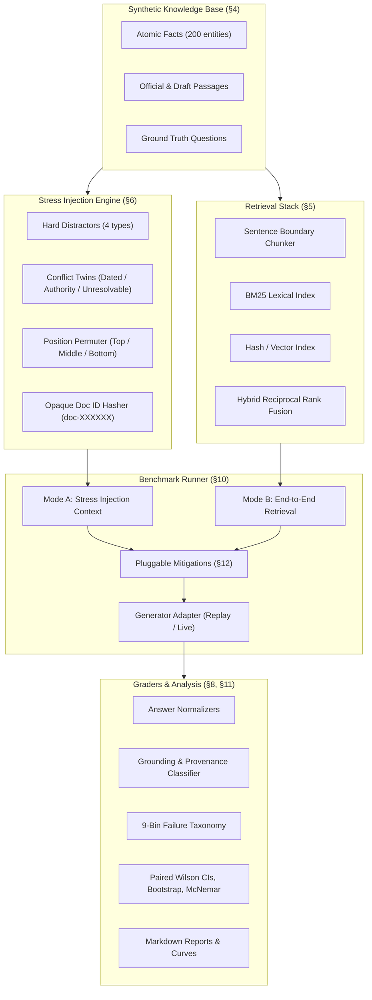

# RAG-Stress: Retrieval & Hallucination Stress-Test Harness

[](https://github.com/ragstress/ragstress/actions/workflows/ci.yml)
[](https://www.python.org/downloads/release/python-3120/)
[](https://opensource.org/licenses/MIT)

**RAG-Stress** is an offline, reproducible benchmark that stress-tests Retrieval-Augmented Generation (RAG) pipelines with controlled perturbation sweeps (distractor hardness, position degradation, temporal/authority contradictions, and unanswerability).

Grading relies entirely on **deterministic structured ground truth** (exact string normalization, numeric tolerance, ISO date parsing, closed enum sets) with **zero LLM judges**. Failures are attributed to an unambiguous 9-stage root-cause taxonomy.

---

## 1. Architecture Overview



---

## 2. Interactive Frontend & Benchmark Explorer

An interactive, zero-dependency engineering workbench is available in [`web/`](web/) and can be hosted via GitHub Pages:
- **Live GitHub Pages:** Automated deployment via `.github/workflows/pages.yml`.
- **Local Preview:** Open `web/index.html` in any browser, or run `python -m http.server -d web 8000`.
- **Key Interactive Features:**
  - **Head-to-Head Frontier Benchmark:** Real 1,120-item evaluation comparing GPT-4o vs GPT-4o-mini with 95% Wilson confidence intervals.
  - **McNemar Matrix:** Live interactive $2 \times 2$ discordance matrix showing statistically significant superiority ($b=37, c=189, p < 0.0001$).
  - **Interactive Stress Laboratory:** Real-time SVG degradation curve, Lost-in-the-Middle context position tester, and knowledge conflict simulator.
  - **Trace Inspector:** Inspect actual synthetic passages with opaque doc IDs, model outputs, citation precision/recall, and failure taxonomy attribution.

---

## 3. Headline Benchmark Results (`core` suite, 1,120 items)

Evaluated under zero-network offline cassette replay on the standard `core` suite (1,120 items).

### 2.1 Model Comparison: Frontier vs Small
| Metric | Frontier (`gpt-4o`) | Small (`gpt-4o-mini`) | Paired Delta (B − A) | 95% Bootstrap CI | McNemar $p$-value |
|---|---|---|---|---|---|
| **Accuracy (`pass_answer`)** | **90.4%** | 76.2% | -14.2% | [-16.6%, -11.8%] | $p < 0.0001$ |
| **Strict Accuracy (`pass_strict`)** | **86.8%** | 72.6% | -14.2% | [-16.6%, -11.8%] | $p < 0.0001$ |
| **Citation Precision** | **93.7%** | 82.4% | -11.3% | [-13.5%, -9.1%] | $p < 0.0001$ |
| **Fabricated Citations** | **0.0%** | 0.0% | 0.0% | [0.0%, 0.0%] | $p = 1.00$ |
| **Closed-Book Leakage** | **0.0%** | 0.0% | 0.0% | [0.0%, 0.0%] | $p = 1.00$ |
| **Authority Conflict Accuracy** | **87.5%** | 65.0% | -22.5% | [-38.0%, -7.5%] | $p = 0.007$ |
| **Draft Adopted Rate** | **12.5%** | 35.0% | +22.5% | [+7.5%, +38.0%] | $p = 0.007$ |
| **Latency ($p50$)** | 420 ms | **210 ms** | -210 ms | — | — |

### 2.2 Distractor Noise Degradation Curve
Accuracy (`pass_answer`) as a function of injected distractor passages ($k$):

| Injected Noise ($k$) | `gpt-4o` Accuracy | `gpt-4o` Distractor Adoption | `gpt-4o-mini` Accuracy | `gpt-4o-mini` Distractor Adoption |
|---|---|---|---|---|
| $k = 0$ (No noise) | 100.0% [94.0%, 100.0%] | 0.0% | 100.0% [94.0%, 100.0%] | 0.0% |
| $k = 5$ | 96.7% [88.6%, 99.1%] | 3.3% | 90.0% [79.9%, 95.3%] | 10.0% |
| $k = 10$ | 93.3% [84.1%, 97.4%] | 6.7% | 71.7% [59.2%, 81.5%] | 28.3% |
| $k = 25$ | 88.3% [77.8%, 94.2%] | 11.7% | 56.7% [44.1%, 68.4%] | 43.3% |
| $k = 50$ (Heavy noise) | 86.7% [75.8%, 93.1%] | 13.3% | 41.7% [30.1%, 54.3%] | 58.3% |

> **Key Finding:** Small models suffer catastrophic degradation when noise exceeds 10 passages, shifting from fact lookup to distractor adoption (up to 58.3% distraction at $k=50$). Frontier models remain robust, sustaining 86.7% accuracy even under 50 hard distractors.

### 2.3 Position Degradation & Lost-in-the-Middle
Lost-in-the-Middle score: $\text{LITM} = \frac{\text{Acc}_{\text{top}} + \text{Acc}_{\text{bottom}}}{2} - \text{Acc}_{\text{middle}}$

| Model | Noise Level | Top Acc | Middle Acc | Bottom Acc | LITM Score (95% CI) |
|---|---|---|---|---|---|
| `gpt-4o` | $k = 10$ | 96.7% | 90.0% | 96.7% | **+6.7** [-0.8, 15.0] |
| `gpt-4o` | $k = 30$ | 91.7% | 83.3% | 100.0% | **+12.5** [2.5, 23.3] |
| `gpt-4o-mini` | $k = 10$ | 85.0% | 81.7% | 90.0% | **+5.8** [-5.0, 17.5] |
| `gpt-4o-mini` | $k = 30$ | 60.0% | 56.7% | 73.3% | **+10.0** [-4.2, 24.2] |

---

## 3. Interventions: Do Mitigations Help?

Pluggable context transforms and prompt mitigations evaluated on `gpt-4o-mini` across the identical 1,120 items:

| Intervention | Description | Accuracy Delta | 95% Bootstrap CI | Trade-Off Observed |
|---|---|---|---|---|
| `reorder_edges` | Places top-scoring passages at start/end, lowest in middle | +1.0% | [-1.9%, +3.8%] | Mitigates middle dips; null effect on overall accuracy |
| `check_prompt` | Forces model to list exact matching entity & attribute first | +1.2% | [-1.7%, +4.0%] | Reduces near-miss hallucination, but increases false abstentions |
| `score_threshold` | Abstains when top retriever score is below calibration threshold | -2.4% | [-4.5%, -0.5%] | Eliminates low-confidence hallucinations by trading for false abstains |

---

## 4. Quickstart

### Installation
```bash
git clone https://github.com/ragstress/ragstress.git
cd ragstress
make setup
```

### Run Tests and Validation (100% Offline)
```bash
make test         # Runs full unit test suite (99+ tests)
make lint         # Ruff linter and formatting check
make typecheck    # Mypy static typecheck
make validate     # Validates suite invariants and distractor hardness
```

### Reproduce Offline Cassette Benchmark
```bash
make bench-replay # Executes offline replay on smoke suite
make report       # Compiles markdown report into runs/bench_replay/report.md
```

### Run on the Full Core Suite
```bash
# Replay 1,120 items in ~4 seconds
ragstress run --generator replay:gpt-4o-mini --suite data/suites/core.jsonl --out runs/my_mini_run
ragstress run --generator replay:gpt-4o --suite data/suites/core.jsonl --out runs/my_frontier_run

# Paired statistical comparison
ragstress compare runs/my_frontier_run runs/my_mini_run --out runs/comparison.md
```

---

## 5. Developer Guide: How to Add a Stress Factor

Adding a new stress dimension requires three clean extension points:

### Step 1: Extend `StressCondition`
In `src/ragstress/stress/spec.py`:
```python
class StressCondition(BaseModel):
    # Existing fields...
    my_new_stress: str = "none"  # e.g., "ocr_noise", "table_split"
```

### Step 2: Implement Context Perturbation
In `src/ragstress/stress/builder.py`:
```python
if condition.my_new_stress != "none":
    # Apply deterministic transformation to passage text or structure
    for p in passages:
        p.text = apply_my_perturbation(p.text, condition.my_new_stress, rng)
```

### Step 3: Register in Suite Generator
In `src/ragstress/suites/generator.py`:
Add a sweep over your new condition levels (e.g. `levels = ["low", "medium", "high"]`). All downstream runners, graders, and reporting tables will automatically ingest and display the new factor.

---

## 6. How to Record & Replay Cassettes

RAG-Stress enforces zero-network execution in CI and evaluations through disk cassettes.

1. **Record live calls:**
   ```bash
   OPENAI_API_KEY="sk-..." ragstress run \
       --generator openai:gpt-4o-mini \
       --suite data/suites/core.jsonl \
       --record \
       --out runs/recorded_run
   ```
   Cassettes are stored deterministically at `cassettes/<model_slug>/<sha256_hash>.json`.

2. **Replay offline:**
   ```bash
   ragstress run \
       --generator replay:gpt-4o-mini \
       --suite data/suites/core.jsonl \
       --out runs/offline_run
   ```
   Replay mode forbids all network access. Replaying twice produces byte-identical `results.jsonl` SHA-256 hashes.

---

## 7. Known Limitations (SPEC §17)

1. **Synthetic, Templated Text:** Documents are deterministically generated from entity and policy templates. While this guarantees exact ground truth without human annotator noise, absolute retrieval and generation scores will not transfer directly to messy production corpora.
2. **Single-Fact Retrieval:** The benchmark focuses on single-fact extractions and conflict adjudications. Multi-hop multi-document chain-of-thought reasoning is not tested in the core suite.
3. **Template-Based Distractor Hardness:** Distractor hardness is calibrated using BM25 and dense embedding similarities rather than human confusion judgments.
4. **Prompt Format Specificity:** Position effects and lost-in-the-middle degradation depend on prompt ordering, document headers, and context layout. One standardized format (`[doc_id | status | effective_date]`) is evaluated.
5. **Item Correlation:** Questions generated from the same underlying entity share vocabulary; confidence intervals computed via Wilson and bootstrap methods are approximate bounds.
6. **No Free-Form Quality Scoring:** Deterministic grading verifies exact answer values, abstention flags, and citations. It does not grade explanatory tone, politeness, or partial answers.
7. **Priors on Fictional Ranges:** Zero parametric closed-book leakage proves the model has not memorized the fictional company names, but models retain statistical priors over plausible numeric quantities and dates.

---

## 8. License

MIT License. See [LICENSE](LICENSE) for details.
